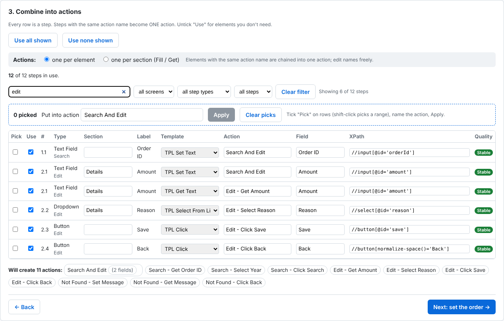
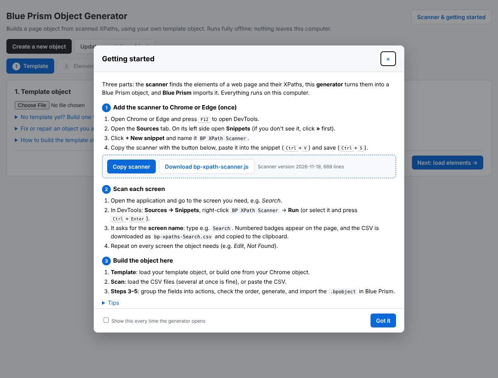

# Blue Prism Object Generator

Build **Blue Prism business objects for web pages** (Chrome / Edge) from scanned XPaths, instead of creating every action by hand.

1. **Scan** a page with the built-in XPath scanner (a DevTools snippet).
2. **Choose** which fields go into which actions.
3. **Import** the generated `.bpobject` into Blue Prism.

Everything runs **offline in your browser**: the generator is a single HTML file, nothing is uploaded anywhere. Built and tested for Blue Prism 7.5.



## Features

- **XPath scanner** for Chrome/Edge DevTools: finds buttons, links, text fields, dropdowns, radios, checkboxes and tables, builds the most stable unique XPath for each, and names fields after their labels.
- **Template-driven**: your own template object decides what each generated step looks like, so the result follows your team's standards.
- **Template builder**: creates a complete template from your existing browser object (one with a "dynamic" action that clicks/reads/writes by XPath).
- **Several screens per object** (e.g. Search, Edit, Not Found), with the screen name in every action name.
- **Skip empty inputs**: a step whose input is empty is skipped, instead of blanking the field on the page.
- **Read-back checks** after writing, with clear exceptions such as `field shows "12", expected "120"`.
- **Error handling**: every action reports *which* action and step failed: `Fill Details / Select Reason: no option "Refund" in the dropdown`.
- **Dropdowns** selected by position after finding the option text, so it works on every dropdown.
- **Read Table** into a collection (one read + a C# code stage).
- **XPaths as data items** on one page, plus an **Update mode** that refreshes them after the website changes.
- **Repair tool** for already generated objects (wrong object references, missing Clean Up / object info stages).
- **Search and filter** when combining many fields into actions; generated **documentation** (HTML/Markdown).

## Quick start

1. Download [`bp-object-generator.html`](bp-object-generator.html) and open it in Chrome or Edge.
2. The **Getting started** guide opens. Click **Copy scanner**, then in DevTools (`F12`) go to **Sources → Snippets → + New snippet**, paste and save.
3. On each screen of the application: right-click the snippet → **Run**, type the screen name (e.g. `Search`). A CSV is downloaded (`bp-xpaths-Search.csv`).
4. In the generator:
   - **Step 1**: load a template object, or build one from your browser object (*No template yet? Build one from your Chrome object*). An example is in [`examples/`](examples/).
   - **Step 2**: load the CSV files.
   - **Steps 3–5**: group the fields into actions, check the order, generate.
5. Import the `.bpobject` in Blue Prism (File → Import) and **test it in a development environment first**.



## Your browser object

Generated objects don't talk to the browser themselves: every step calls **one action of your own browser object** that works by XPath. The template builder recognises its inputs by name (an `I_` prefix is fine):

| Meaning | Typical name | Type |
|---|---|---|
| Attempts | `Attempts` | Number |
| Page title / page titles to attach to | `Page Title`, `Page Titles` | Text |
| The element | `XPath` | Text (required) |
| Click / Read / Write | `Click`, `Read`, `Write` | Flag |
| Value to pick in a dropdown | `Select` | Text |
| Text to write | `Text` | Text |
| Read the **selected** dropdown item (optional, for dropdown checks) | `Read Selected` | Flag |
| Output: the text read | `Text` | Text |

You can correct the mapping in the builder if your names differ. The dropdown position format (default `option={n}`) is configurable too.

## Template pages

Pages whose name starts with `TPL` are patterns the generator copies (placeholders: `{{XPATH}}`, `{{FIELD}}`, `{{LABEL}}`, `{{ACTION}}`, `{{DESCRIPTION}}`):

| Page | Used for |
|---|---|
| `TPL Click`, `TPL Click (Row)` | buttons and links (Row: in a table row given by a Row Key) |
| `TPL Set Text` | text fields |
| `TPL Select From List` | dropdowns: finds the option by text, then selects it by position |
| `TPL Set Checkbox`, `TPL Select Radio` | checkboxes, radio groups (one action per group) |
| `TPL Get Text`, `TPL Get Text (Row)` | reading values |
| `TPL Read Table` | tables into a collection (first row = column names) |
| `TPL Verify Text`, `TPL Verify Select` | read-back check after writing |
| `TPL Error Handler` | Recover → exception with action and step |
| `TPL XPaths` | model for the `XP …` data items |

## Settings (step 1)

| Setting | What it does |
|---|---|
| **Calls to other objects** | The object/action every step calls. Must match the name in Blue Prism **exactly**. |
| **Shared inputs** | Inputs needed once per action (e.g. `I_Title`), not once per field. |
| Input / Output prefix | `I_` on Start inputs, `O_` on End outputs. A field's value takes the field's name (`I_Amount`). |
| Local data items | Helper items: one per action (`Actual`) or one per field (`Amount Actual`). |
| Group data items | Arranges data items into *Inputs / Outputs / Local data* boxes. |
| Action verbs, Title Case | Your team's wording: `Set → Enter` gives `Enter Amount`. |
| **XPaths as data items** | All XPaths on one `Element XPaths` page; needed for Update mode. |
| Write descriptions | Descriptions for the object, actions and inputs. |
| **Check fields after writing** | Read-back check after each write. |
| **Add error handling** | Clear error messages with action and step. |

## Changing an existing object

| Situation | What to do |
|---|---|
| The website changed | Rescan, then **Update an existing object**: only the XPath values change. |
| Wrong object reference in every step | Step 1 → **Fix or repair an object you already generated**: fix one stage by hand, export, *Use for all*. |
| "Object reference not set to an instance of an object" / empty Clean Up | The same repair tool adds the missing stages (new objects get them automatically). |
| New template logic | Generate again with the same object name, screens and grouping, and import over the old object. Action and input names stay the same. |

## Known limits

- **Dropdown checks** need a "read selected item" input in your browser object; reading a `<select>` element normally returns all its options.
- **Read Table**: a cell with a line break in the *last* column becomes an extra short row.
- **Checkboxes**: `TPL Set Checkbox` clicks when `I_Checked` is True, so it assumes the box starts unticked.

## Development

```bash
npm install
npx playwright install chromium
npm test            # runs tests/run-all.js (30 test scripts)
```

`run-table.js` also needs the Mono C# compiler (`mcs`) to compile the Read Table code stage.
The scanner lives in `bp-xpath-scanner.js` and is embedded in the generator: after changing it, run `npm run sync-scanner`.

## License

[MIT](LICENSE). Not affiliated with or endorsed by Blue Prism or SS&C Technologies; Blue Prism is a trademark of its respective owner.
